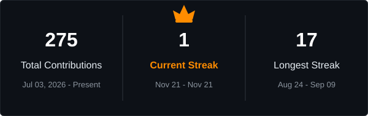

<h1 align=center>Hi 👋, I'm Mithun A naik</h1>

<h3 align=center></h3>

  

- 📬 Email -**mithunnaik28c@gmail.com**

<h3>💻 languages and tools:</h3>

                   

<h3> 📊 GitHub Stats: </h3>

<h4 align=center> Thank you,🙏</h4>
